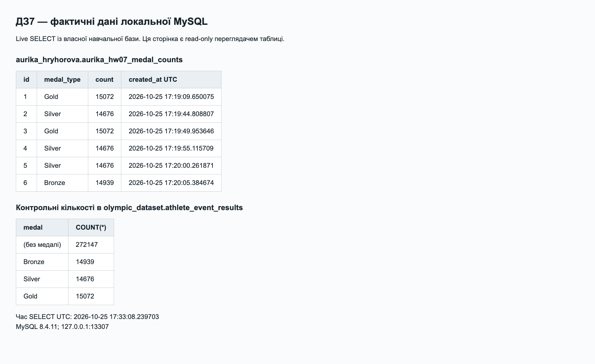
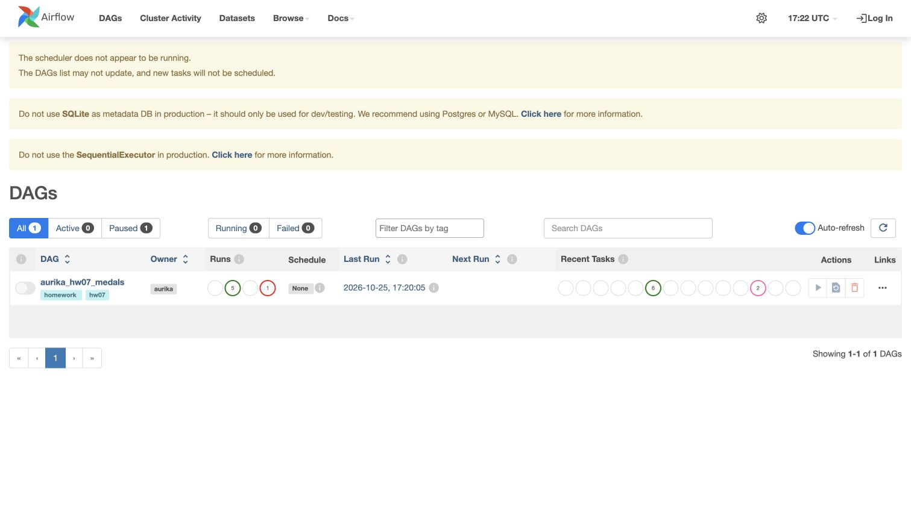
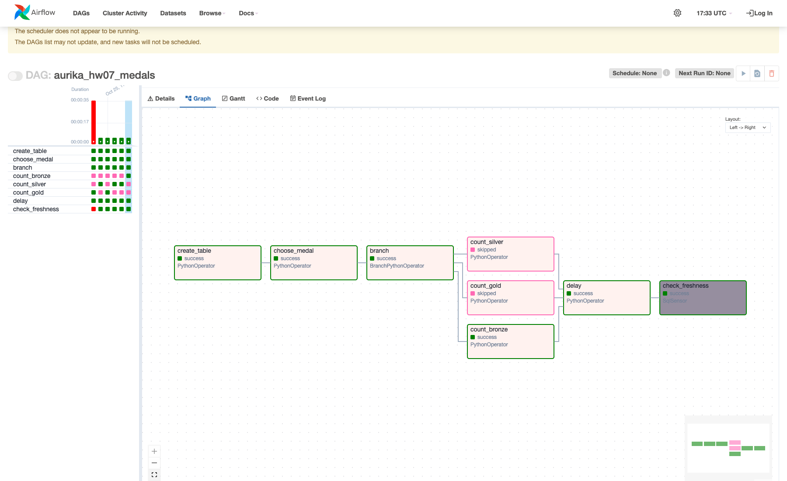
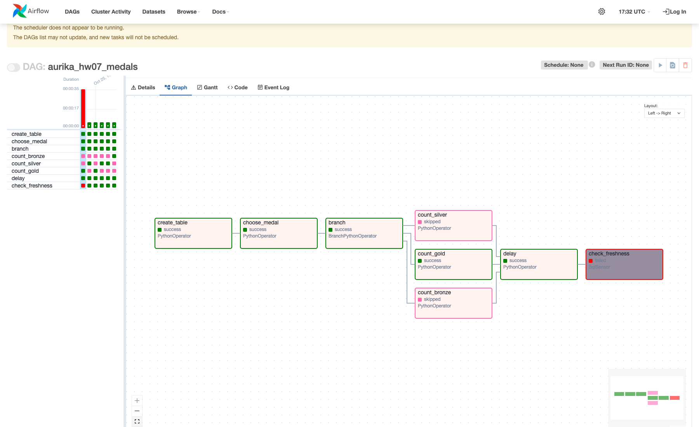
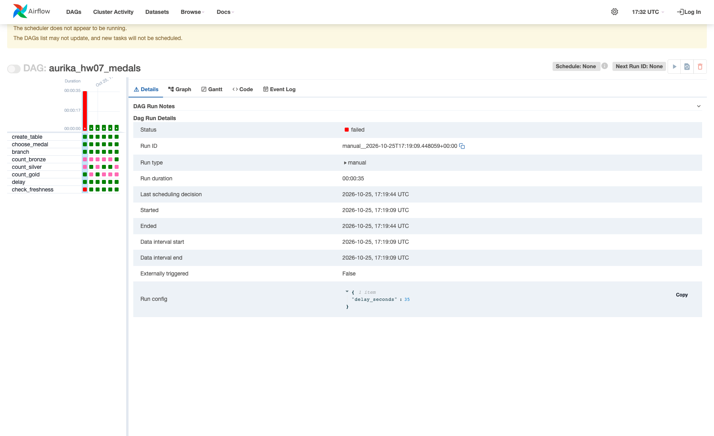

# Домашня робота 7 — Apache Airflow

Григорова Ауріка Вадимівна · 25 жовтня 2026 року

## Короткий опис

DAG aurika_hw07_medals створює власну таблицю MySQL, випадково обирає Bronze, Silver або Gold, запускає лише відповідну гілку підрахунку, записує результат, виконує паузу й перевіряє вік цього запису стандартним SqlSensor.

Підготовлено окреме локальне середовище: Python 3.12.4, Airflow 2.11.2, MySQL 8.4.11, MySQL provider 6.5.0, common-sql 1.32.0. Запуски виконано через dag.test(): завдання підключалися до MySQL, передавали значення через XCom і чекали через time.sleep. Окремо пройшли 8 mock-тестів із підставленими відповідями БД. Scheduler/executor та примусове застосування їхніх timeout цим способом не перевірялися. Попередження UI про scheduler очікуване.

## Дані й таблиця

Джерело — публічний Olympic_Athlete_Event_Results.csv, commit 21b851f8fbe775332b1bc43b9dac213b4087e80b у sfc-gh-mconsoli/olympic_games_data_hub. У власну локальну olympic_dataset.athlete_event_results імпортовано проєкцію medal всіх 316834 рядків із номером вихідного рядка. Тотожність цього CSV віддаленому набору даних GoIT не перевірялася. SHA-256 CSV: 4a76c66fc6f69a2f69b4a953298d475fd61fb46a40ac5995ea738bc94695905b.

Контрольні кількості: Bronze 14939, Silver 14676, Gold 15072. CSV Counter, MySQL GROUP BY і DAG дали однакові числа. Рахуються записи спортсменів, включно з учасниками команд.

Власна aurika_hryhorova.aurika_hw07_medal_counts має чотири поля: id AUTO_INCREMENT PRIMARY KEY, medal_type, count, created_at DATETIME(6). DAG не змінює source table.



## Порядок завдань

create_table, choose_medal, branch, одна з count_bronze/count_silver/count_gold, delay, check_freshness.

Три count tasks використовують PythonOperator і MySqlHook; кожна має свій тип медалі й параметризований SQL. Окрема random task викликає random.choice, а окремий BranchPythonOperator повертає id обраної гілки. Дві інші гілки мають skipped.

Delay — PythonOperator з time.sleep та none_failed_min_one_success. Skipped не блокують join; failure обраної гілки не приховується. У DAG задано max_active_runs=1, max_active_tasks=1 і retries=0.

Sensor читає точний inserted id поточного run із XCom і перевіряє medal_type. Один run створює один результат; чужий або паралельний свіжий рядок не допоможе пройти перевірку. Час INSERT і перевірки — UTC_TIMESTAMP(6) тієї самої MySQL. Sensor приймає цілі мікросекунди 0..30000000, відхиляє старий, майбутній, NULL і відсутній запис. timeout=10, execution_timeout=20, soft_fail=False. Старий запис одразу викликає failure.

## Реальні запуски

Виконано 6 запусків: п’ять success із паузою 5 секунд та один очікуваний failed із паузою 35 секунд. У кожному запуску медаль обирав random.choice. Запуски повторювалися до перевірки всіх трьох гілок.

| Run ID (UTC) | Пауза, с | Медаль | id MySQL | Стан |
|---|---:|---|---:|---|
| manual__2026-10-25T17:19:09.448059+00:00 | 35 | gold | 1 | failed |
| manual__2026-10-25T17:19:44.726119+00:00 | 5 | silver | 2 | success |
| manual__2026-10-25T17:19:49.876227+00:00 | 5 | gold | 3 | success |
| manual__2026-10-25T17:19:55.039511+00:00 | 5 | silver | 4 | success |
| manual__2026-10-25T17:20:00.181733+00:00 | 5 | silver | 5 | success |
| manual__2026-10-25T17:20:05.311138+00:00 | 5 | bronze | 6 | success |



## Успішний приклад

Run manual__2026-10-25T17:20:05.311138+00:00 обрав Bronze. Count дорівнює 14939, вставлений id=6. Після паузи 5 секунд sensor прочитав 5.062583 секунди й завершився success. Невибрані Silver і Gold мають skipped.



## Негативний приклад: 35 секунд

Run manual__2026-10-25T17:19:09.448059+00:00 обрав Gold. Count 15072 записано під id=1. Count і delay успішні, дві інші гілки skipped. Після паузи 35 секунд sensor прочитав 35.063458 секунди й завершився failed одразу за failure-предикатом. Run завершився приблизно за 35 секунд; стан вручну не змінювався.

Фрагмент журналу Airflow:

```text
Age of this run's row: 35.063458 seconds; allowed: 0..30
AirflowException: Failure criteria met. self.failure(35063458) returned True
Marking task as FAILED. dag_id=aurika_hw07_medals, task_id=check_freshness
```





## Перевірки й виправлення

DagBag завантажив 8 tasks без import errors; pip check не знайшов несумісних залежностей. Пройдено 8 mock-тестів, включно з rollback, join, XCom scope, missing/NULL/future/old row та межами віку. Після перевірки SQL-ділення замінено на цілі мікросекунди: 30.000001 секунди вже відхиляється. Цю межу додатково перевірено в MySQL.

Додатково звірено контрольну суму CSV, усі 6 рядків результатів MySQL, структуру таблиці, стани завдань, XCom id та журнал запусків. Після виправлення помилки округлення розбіжностей не знайдено. Деталі та межі перевірки — evidence/review.uk.md.

Повний журнал запусків — evidence/airflow-runs.log; у ньому лише абсолютний персональний шлях замінено на `<workspace>`. Машиночитні докази — runs.json, source.json, real-verification.json. Детальні команди підготовки, повторення й зупинки — guide.uk.md. Наявні результати не потрібно очищати для повторення: використовується окрема нова копія середовища.

## Матеріали для здачі

Власний repo: https://github.com/diagnosel/goit-de-hw-07

Українська документація: https://app.notion.com/p/401a96dc80e58106af14c76711d45928?pvs=204

Архів ДЗ7_Григорова_Ауріка_Вадимівна.zip містить код, цей документ зі скриншотами та докази. Venv, MySQL binaries/data, CSV, metadata DB, credentials і тимчасові файли не додаються. Для здачі потрібно завантажити архів і посилання на репозиторій у LMS.
